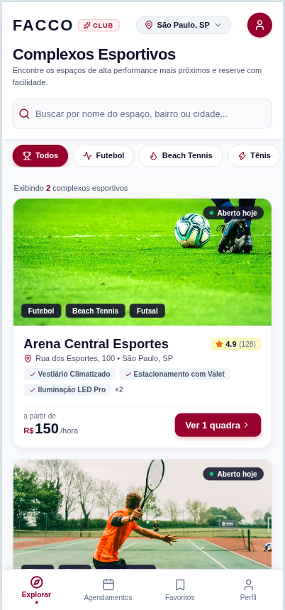
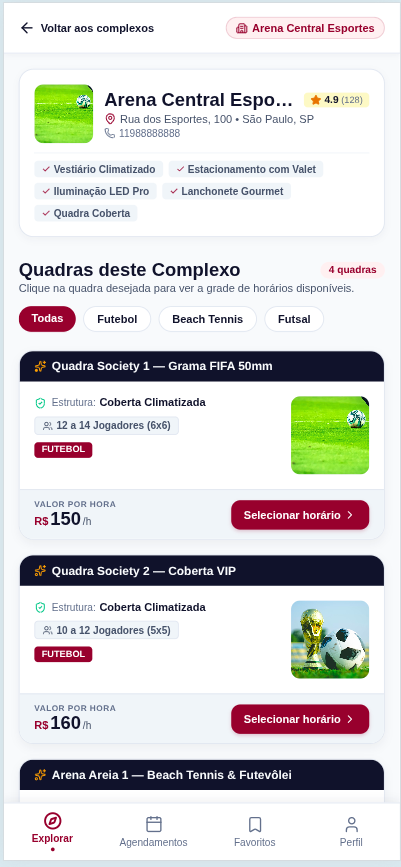

<div align="center">

# FACCO — Sports Court Booking App

**Cross-platform client (Web · iOS · Android) to discover sports venues and book courts in seconds.**

[](https://expo.dev/)
[](https://reactnative.dev/)
[](https://react.dev/)
[](#-getting-started)
[](https://web.dev/progressive-web-apps/)
[](https://github.com/DiovaniFacco/back)

[Overview](#-overview) · [Screens](#-screens) · [Features](#-features) · [Architecture](#-architecture) · [Getting started](#-getting-started) · [Deployment](#-deployment)

</div>

---

## 📖 Overview

The customer-facing app of a **white-label sports booking platform**. Users browse complexes near them, filter courts by sport, see live availability and reserve a slot; venue managers get a full operations dashboard (agenda, pricing, blocks, metrics) inside the same app.

Built once with **Expo / React Native** and shipped to **web (installable PWA), iOS and Android** from a single codebase.

> **Product:** FACCO · **Codebase name:** SportsF · **Domain:** `sfacco.com.br`

---

## 📱 Screens

| Explore venues | Venue & courts |
| :---: | :---: |
|  |  |

---

## ✨ Features

### For customers
- **Browse & discover** complexes with cover images, ratings, amenities and "open today" status.
- **Search and filter** by name, city or **sport** (football, beach tennis, tennis, futsal…).
- **Court details** — structure, capacity, price per hour and sport badges.
- **Real-time availability** — pick a date, see free slots and select one or several.
- **Booking flow** with confirmation, price summary and schedule legend.
- **My bookings** — upcoming and past reservations, with cancellation rules respected.
- **Profile & reviews** — edit account, rate venues you've actually played at.
- **360° auth** — register, login, forgot password, reset by e-mail deep link, plus Google sign-in hooks.

### For managers
- **Operations dashboard** with schedule, bookings, metrics and a simplified hand-off view for employees.
- **Court management** — create/edit courts, sports, structure, images and details.
- **Operating hours editor** with **multiple shifts per day**.
- **Dynamic pricing** — peak-hour rules and holiday special prices.
- **Agenda control** — timed/indefinite blockouts and **recurring fixed schedules** (classes / monthly clients) with single-day exceptions.
- **Manual booking** for phone/WhatsApp customers, keeping the grid consistent.
- **Access analytics** — visits (anonymous vs. logged) and page views for their own venues.

### Platform capabilities
- **Multi-tenant white-label** — a venue can be reached by **subdomain** (`recanto.sfacco.com.br`), by path (`/complexo/{slug}`) or by env default, and the app opens straight into it.
- **Simplified mode** — locks the navigation to a single venue when the complex runs on its own white-label domain.
- **Secure session storage** — tokens kept in `expo-secure-store`.
- **Privacy-conscious telemetry** — anonymous `visitor_id` / `session_id`, best-effort and never blocking the UI.
- **Theming** — centralized Light/Dark design tokens.
- **Installable PWA** with manifest and service worker.

---

## 🏗️ Architecture

```
App.js                      # root navigator + white-label / deep-link routing
├── src/
│   ├── api/                # axios modules, one per resource
│   │   ├── client.js       #   base URL, interceptors, auth token
│   │   ├── auth.js  venues.js  courts.js  slots.js  bookings.js
│   │   └── pricing.js  fixedSchedules.js  operatingHours.js  courtBlocks.js …
│   ├── components/         # reusable UI (common, complexes, courts, slots, manager)
│   ├── context/            # AuthContext, ThemeContext
│   ├── screens/            # customer + manager/ screens
│   ├── services/           # analytics, secure storage
│   ├── utils/              # linking (white-label), datetime, whatsapp, payment…
│   └── styles/theme.js     # design tokens (v2.3.0)
└── public/                 # PWA manifest, service worker, icons
```

**Customer screens:** `Complexes`, `VenueCourts`, `CourtSlots`, `MyBookings`, `Profile`, `Login`, `Register`, `ForgotPassword`, `ResetPassword`.
**Manager:** `manager/ManagerHomeScreen` + 15+ management modals (court form, pricing, blockouts, fixed schedules, manual booking, metrics…).

---

## 🚀 Getting started

### 1. Requirements
- Node.js 20+
- Expo CLI (via `npx`)
- The backend running (see **[DiovaniFacco/back](https://github.com/DiovaniFacco/back)**)

### 2. Install

```bash
git clone https://github.com/DiovaniFacco/front.git
cd front
npm install
```

### 3. Configure

```bash
cp .env.example .env
```

```env
# Local backend
EXPO_PUBLIC_API_URL=http://localhost:8000/api/v1
# White-label (optional): open straight into a venue
EXPO_PUBLIC_VENUE_SLUG=
EXPO_PUBLIC_TENANT_DOMAIN=sfacco.com.br
```

> ⚠️ Web bundles embed `EXPO_PUBLIC_*` values **at build time**. Production builds read [`.env.production`](.env.production) automatically — never publish a build produced with the dev URL.

### 4. Run

```bash
npm run dev        # Expo dev server (press w / a / i to pick a platform)
npm run web        # web only
npm run android    # Android
npm run ios        # iOS
```

There is also a convenience `./dev.sh` script that boots backend and frontend together with prefixed logs.

---

## ⚙️ Scripts

| Script | Description |
| --- | --- |
| `npm run dev` | Start the Expo dev server |
| `npm run web` / `android` / `ios` | Run on a specific platform |
| `npm run build` | Export the production **web** bundle to `dist/` |
| `npm start` | Serve the exported `dist/` as a static SPA |

---

## 📦 Deployment

The web build is a static SPA (`dist/`) and is hosted on **Railway**, served with `serve -s dist` on the injected `$PORT`:

```bash
npm run build      # expo export --platform web  →  dist/
npm start
```

Make sure `.env.production` points `EXPO_PUBLIC_API_URL` at the deployed API before building. Native builds are produced with Expo/EAS.

---

## 🎨 Design system

The UI follows a documented design system — brand identity, color tokens, typography, spacing, components and accessibility rules. See [`DESIGN_SYSTEM.md`](DESIGN_SYSTEM.md); the live tokens are in [`src/styles/theme.js`](src/styles/theme.js) (Vinho Imperial `#881337` + Slate, light/dark).

---

## 👤 Author

**Diovani Facco**

[](https://github.com/DiovaniFacco)
[](https://www.linkedin.com/in/diovani-facco-3a247b11a/)
[](mailto:diovanifacco@gmail.com)

> Backend repository: **[DiovaniFacco/back](https://github.com/DiovaniFacco/back)** — Laravel 12 + PostgreSQL API.
